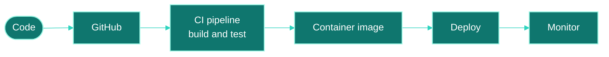

# Readme.md

 

### DEVOPS INTERN

 

<!-- TODO: add a LOCATION badge if you want one, e.g.
 -->

 

<h3 align="center">
I'm learning to build cloud systems where 
deployments are repeatable, 
failures are visible, 
and nothing depends on "it works on my machine."
</h3>

 

 

<!-- TODO: keep only the tools you have actually used. Delete the rest. -->

<b><code>CLOUD</code></b> 
    

<b><code>CONTAINERS</code></b> 
 

<b><code>DELIVERY</code></b> 
 

<b><code>INFRASTRUCTURE AS CODE</code></b> 
 

<b><code>SCRIPTING · TOOLS</code></b> 
     

 

 

<!-- TODO: edit this diagram so it matches the pipeline you actually use. -->

 

 

<!-- TODO: replace each placeholder with a real project. Only add numbers you can back up. -->

### 01 · Project name goes here

> One sentence on what it does and why you built it.

- What you built (for example: a CI/CD pipeline, a Docker setup, a Terraform module)
- A tool or decision worth mentioning
- A problem you hit and how you fixed it

  

 

### 02 · Project name goes here

> One sentence on what it does and why you built it.

- What you built
- A tool or decision worth mentioning
- A problem you hit and how you fixed it

  

 

 

<!-- TODO: swap in what you are actually learning right now. -->

 

 

 

## Let's talk DevOps.

<!-- TODO: add your LinkedIn and email, then remove this comment.

-->

