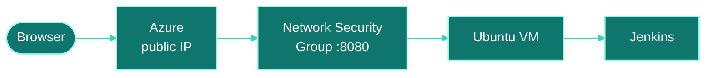

 

### DEVOPS INTERN

 

<!-- TODO: add a LOCATION badge if you want one, e.g.
 -->

 

<h3 align="center">
I'm learning to build cloud systems where 
deployments are repeatable, 
failures are visible, 
and nothing depends on "it works on my machine."
</h3>

 

 

<!-- TODO: add badges for the microservices and student CRUD projects once you share their stacks (language, framework, database, Docker). -->

<b><code>CLOUD</code></b> 
     

<b><code>CI/CD</code></b> 

<b><code>SYSTEMS · TOOLS</code></b> 
     

<b><code>LANGUAGES</code></b> 
  

 

 

### 01 · Jenkins Deployment on an Azure Virtual Machine

> Installed and configured Jenkins on an Ubuntu VM in Azure and opened it up for browser access, as a base for CI tasks.
>
> [View repository](https://github.com/shraddha-24-dev/jenkins-on-azure-vm)

- Created the Azure VM, connected over SSH, and installed Java (OpenJDK) and Jenkins
- Managed the Jenkins service with `systemctl`
- Opened port 8080 in the Network Security Group and completed the initial Jenkins setup
- **Next:** connect Jenkins to GitHub, build CI/CD pipelines, deploy a sample Java app, add Docker

    

 

### 02 · Static Website Hosting on Amazon S3

> Set up Amazon S3 for static website hosting with a bucket policy and an index document.
>
> [View repository](https://github.com/shraddha-24-dev/aws-s3-static-website)

- Created the S3 bucket, uploaded the HTML and CSS files, and enabled static website hosting
- Configured bucket permissions with IAM and a bucket policy, and set `index.html` as the index document
- Tested through the S3 website endpoint
- **Next:** finish the live S3 deployment (the site files are in the repo)

    

 

### 03 · Microservices Project

> TODO: one sentence on what it does.
>
> [View repository](https://github.com/shraddha-24-dev/REPO-NAME)

- TODO: which services you built
- TODO: how they talk to each other
- TODO: how you ran or deployed them (Docker? Compose? a cloud VM?)

 

### 04 · Student Database (CRUD) Application

> TODO: one sentence on what it does.
>
> [View repository](https://github.com/shraddha-24-dev/REPO-NAME)

- TODO: stack (language, framework, database)
- TODO: the Create, Read, Update and Delete features
- TODO: anything you did to run or deploy it

 

 

 

 

 

## Let's talk DevOps.

<!-- TODO: add your LinkedIn and email, then remove this comment.

-->

